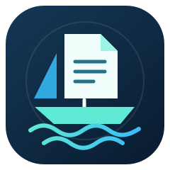

<p align="center">
  
</p>

<h1 align="center">PaperHarbor</h1>
<p align="center"><strong>A home for your research PDFs.</strong></p>
<p align="center">Open-access PDF discovery for Zotero, BibTeX, and CSL-JSON libraries.</p>
<p align="center">Created by <a href="https://github.com/sayanmondal2098">Sayan Mondal</a></p>
<p align="center"><a href="https://sayanmondal2098.github.io">Personal website</a></p>

PaperHarbor turns a Zotero library, BibTeX bibliography, or CSL-JSON export into an organized collection of available open-access PDFs. Browse references in the local web interface, select papers, and save them to a folder you choose, or use the command line for repeatable batches. Zotero is optional when importing a bibliography or retrying a CSV report.

**Zotero supplies the references; your personal folder receives the downloads.** PaperHarbor does not attach downloaded files to Zotero or update its records. The local database reader queries a temporary copy of the database.

## Contents

- [Features](#features)
- [How it works](#how-it-works)
- [Requirements and installation](#requirements-and-installation)
- [Quick start](#quick-start)
- [Web interface](#web-interface)
- [Reference sources](#reference-sources)
- [Command-line options](#command-line-options)
- [Usage examples](#usage-examples)
- [ACM Digital Library and other domains](#acm-digital-library-and-other-domains)
- [PDF discovery](#pdf-discovery)
- [Files and naming](#files-and-naming)
- [CSV reports](#csv-reports)
- [Recovering failed downloads](#recovering-failed-downloads)
- [Troubleshooting](#troubleshooting)
- [Limitations and data handling](#limitations-and-data-handling)
- [Project structure](#project-structure)
- [Development and tests](#development-and-tests)
- [Contributing](#contributing)
- [Author](#author)
- [License](#license)

## Features

| Feature | What it provides |
| --- | --- |
| Multiple reference sources | Local `zotero.sqlite`, CSL-JSON, BibTeX, Zotero Web API, or unresolved rows from a previous CSV report |
| Personal and group libraries | API access using a user ID or a group ID |
| Missing-PDF detection | Checks attachment metadata and skips items already marked as having PDFs by default |
| Multiple discovery providers | ACM Digital Library, Unpaywall, OpenAlex, arXiv, Europe PMC, Semantic Scholar, and Crossref |
| Landing-page resolution | Attempts to extract PDF links from article pages and stored Zotero URLs |
| Download checks | Looks for a `%PDF-` header in the first 1,024 bytes and rejects downloads smaller than 1,024 bytes |
| Organized filenames | Configurable year, author, and title templates with filename sanitization |
| Local web interface | Direct file uploads, library search, collection filters, Select all / Unselect all, progress, results, and logs |
| CSV reporting | Per-reference status, provider, saved path, URLs, and diagnostic notes |
| Automatic recovery | Bounded retries, expanded provider searches, alternate PDF links, and CSV report retries |
| Manual follow-up | Publisher/repository links, suggested filenames, and per-URL attempt details |
| Reference checks | Rejects conflicting DOI matches, recognizes selected web resources, and records arXiv withdrawal notices |

## How it works

```text
Zotero database / BibTeX or CSL-JSON / Web API / CSV retry report
                           |
                    Read reference metadata
                           |
              Apply collection / selection / limit
                           |
            Skip existing attachments and local files
                           |
              Discover candidates and resolve PDF links
                           |
                 Download and check PDF header
                           |
                Personal PDF folder + CSV report
```

Each reference receives an outcome in the report, including references skipped because Zotero already has a PDF. Processing is sequential, with a default pause of 0.5 seconds between references.

## Requirements and installation

- **Python 3.8 or later.** The project does not currently declare a tested Python-version matrix.
- A local Zotero database, supported bibliography file, previous PaperHarbor report, or credentials for a Zotero API library.
- An internet connection for provider searches and downloads.
- A writable destination folder.

Runtime dependencies are `requests>=2.28.0` and `beautifulsoup4>=4.11.0`; see [requirements.txt](requirements.txt). The web server uses Python's standard library. Its optional **Browse...** folder picker also requires `tkinter`; paths can be entered manually if it is unavailable.

Clone the repository:

```bash
git clone https://github.com/sayanmondal2098/PaperHarbor.git
cd PaperHarbor
```

**Windows PowerShell:**

```powershell
python -m venv .venv
.\.venv\Scripts\Activate.ps1
python -m pip install -r requirements.txt
```

**macOS / Linux:**

```bash
python3 -m venv .venv
source .venv/bin/activate
python -m pip install -r requirements.txt
```

Run the following commands from the repository root. If PowerShell prevents activation, use `.\.venv\Scripts\python.exe` instead of `python` to install dependencies and run the app directly.

## Quick start

Start with a small batch using your local Zotero library:

```powershell
python main.py --dest-folder "D:\Research\Papers" --email "you@example.com" --limit 5
```

On macOS or Linux:

```bash
python main.py --dest-folder "$HOME/Research/Papers" --email "you@example.com" --limit 5
```

PaperHarbor attempts to locate `zotero.sqlite`, creates the destination directory if needed, processes the first five references, and saves a timestamped CSV report alongside downloaded PDFs. Remove `--limit 5` to process the full library.

The limit applies to references evaluated, including skipped items; it is not a target number of successful downloads.

The package entry point is equivalent:

```powershell
python -m paperharbor --dest-folder "D:\Research\Papers" --limit 5
```

### Start from a BibTeX file without Zotero

```powershell
python main.py --export-file "references.bib" --dest-folder "D:\Research\Papers"
```

Or run `python web.py`, choose **Upload bibliography / retry report**, and select or drop your file. References load automatically for selection.

## Web interface

Launch the browser interface:

```bash
python web.py
```

The server opens your default browser at **http://127.0.0.1:8765/** and binds to `127.0.0.1` only.

1. Enter a destination folder or choose **Browse...**.
2. Choose a local Zotero database, bibliography/report upload, local export path, or the Zotero Web API.
3. Fill in the source path or credentials. Leave the SQLite path blank for automatic detection.
4. Optionally set a contact email, reference limit, filename template, or download overrides.
5. Click **Load references**, or choose **Upload bibliography / retry report** and select/drop a `.bib`, `.bibtex`, CSL-JSON `.json`, or PaperHarbor `.csv` report. Uploads up to 5 MB load automatically; Zotero is not required for this source.
6. Filter by collection, search by title / author / DOI, and select papers individually. **Select all** selects every loaded reference, including those hidden by filters; **Unselect all** clears the entire selection. **Select shown** and the table header checkbox affect only visible references.
7. Click **Download N selected references** and follow the progress, per-paper outcomes, activity log, and final CSV report path. Optional settings are under **Download settings**.

The library browser initially shows only references without a PDF attachment. Load references and select at least one paper before downloading. To process the full library, use **Select all**. Uploads are parsed through temporary files that are removed after reading; their reference data remains in memory for the job.

To fetch items already marked as having a PDF, enable **Include references with an existing PDF attachment** under Download settings. Changing the source clears the old selection so references from different sources are not mixed.

Choose another port or suppress automatic browser opening:

```bash
python web.py --port 9000 --no-browser
```

Open `http://127.0.0.1:9000/` manually in that case. One download job can run at a time. Keep the server running until the job completes; press `Ctrl+C` in its terminal to stop the server.

## Reference sources

### Local Zotero database

Automatic detection checks `~/Zotero/zotero.sqlite` and common Zotero profile directories on Windows, macOS, and Linux. For a custom location, provide the database file explicitly:

```powershell
python main.py -d "D:\Research\Papers" -z "C:\Users\YourName\Zotero\zotero.sqlite"
```

The reader copies the main database and attempts to copy WAL/SHM companion files when present, queries the temporary snapshot, then removes it. It does not write to the original database. PDF detection uses attachment metadata rather than checking whether every attachment exists on disk.

### CSL-JSON and BibTeX exports

Export a library or collection from Zotero as **CSL JSON** or **BibTeX**, then pass the file:

```powershell
python main.py -d "D:\Research\Papers" --export-file "my_collection.json"
python main.py -d "D:\Research\Papers" --export-file "my_collection.bib"
```

Supported extensions are `.json`, `.bib`, and `.bibtex`. Attachment detection depends on PDF information in the export's `file` field. Exported references may be treated as missing PDFs even when Zotero has attachments.

The export reader does not apply collection filters; export the desired collection itself. BibTeX support uses a lightweight parser and may not handle every complex BibTeX construct.

### Zotero Web API

Use a key with read access to the target library and supply either a user ID or a group ID.

**Personal library:**

```powershell
python main.py -d "D:\Research\Papers" --api-key "YOUR_ZOTERO_API_KEY" --user-id "YOUR_USER_ID"
```

**Group library:**

```powershell
python main.py -d "D:\Research\Papers" --api-key "YOUR_ZOTERO_API_KEY" --group-id "YOUR_GROUP_ID"
```

Supply only the appropriate ID. The web interface requires one ID; on the CLI, the user library takes precedence if both are supplied. The reader retrieves item and attachment metadata rather than downloading Zotero's stored attachments.

If multiple source options are supplied, selection follows this order: **export file → API key → local SQLite database**.

## Command-line options

Display built-in help:

```bash
python main.py --help
```

| Option | Description | Default |
| --- | --- | --- |
| `-d`, `--dest-folder` | Folder for downloaded PDFs | Required |
| `-z`, `--zotero-path` | Path to `zotero.sqlite` | Auto-detect |
| `-e`, `--email` | Contact email included in provider requests | `paperharbor.downloader@gmail.com` |
| `-c`, `--collection` | Case-insensitive collection-name substring filter for SQLite/API sources | All references |
| `-l`, `--limit` | Evaluate the first N references; use a positive integer | No limit |
| `-r`, `--report` | Custom CSV report path | Timestamped report in destination |
| `--include-zotero-has-pdf` | Also search for items already marked as having a Zotero PDF | Disabled |
| `--force-redownload` | Bypass the existing-destination skip check | Disabled |
| `--template` | Filename template using `{year}`, `{author}`, and `{title}` | `{year}_{author}_{title}.pdf` |
| `--export-file` | Read a `.json`, `.bib`, or `.bibtex` export | Unset |
| `--retry-report` | Retry failed/manual/error rows from a PaperHarbor CSV report | Unset |
| `--retry-not-found` | Also include no-copy-found rows when using `--retry-report` | Disabled |
| `--pdf-overrides` | JSON mapping item keys or DOIs to verified alternate PDF URLs | Unset |
| `--api-key` | Zotero API key | Unset |
| `--user-id` | Zotero personal-library user ID | Unset |
| `--group-id` | Zotero group-library ID | Unset |
| `-v`, `--verbose` | Enable debug logging | Disabled |
| `-h`, `--help` | Show help and exit | — |

Use your own contact email with `--email` when possible. Existing-file skipping checks the generated filename, a size greater than 1,024 bytes, and a PDF header; it does not match files by DOI.

## Usage examples

Process a collection whose name contains `Thesis`:

```powershell
python main.py -d "D:\Research\Papers" --collection "Thesis"
```

Choose a custom report path and filename layout:

```powershell
python main.py -d "D:\Research\Papers" --report "D:\Research\Reports\summary.csv" --template "{author}_{year}_{title}.pdf"
```

Build a separate PDF collection even for items already attached in Zotero:

```powershell
python main.py -d "D:\Research\Papers" --include-zotero-has-pdf
```

Retry downloads even when matching filenames exist, with debug output:

```powershell
python main.py -d "D:\Research\Papers" --force-redownload --verbose
```

`--force-redownload` bypasses destination skipping. Existing filenames still receive numeric suffixes for new downloads; this flag does not overwrite them. It also does not override the Zotero-attachment skip rule, so combine it with `--include-zotero-has-pdf` when needed.

## ACM Digital Library and other domains

ACM articles are recognized automatically from `10.1145/...` DOIs and `dl.acm.org` article URLs in Zotero or uploaded exports. A dedicated **ACM Digital Library** provider tries the article PDF and ePDF viewer routes. Legacy ACM citation links can be resolved when their article metadata or redirects are available. No separate ACM API key is required.

Crossref PDF links are accepted when their URL identifies a PDF, including ACM links whose content type is `unspecified`. If ACM returns HTTP 403, PaperHarbor tries other available sources and offers the ACM article link for normal browser access. This support does not bypass site controls or guarantee automated access. See [ACM's open-access information](https://www.acm.org/publications/openaccess).

Supported URL forms also include IEEE article/viewer URLs, OpenReview forum-to-PDF links, IACR ePrint links, HAL repository document links, repository download buttons, and same-host PDF.js viewers. Requests identify the downloader as PaperHarbor.

Title searches use conservative normalized matching. A title-search result, publisher redirect, candidate DOI URL, or article `citation_doi` that contradicts the reference DOI is rejected. This reduces the risk of downloading a similarly titled but different paper. Review title-only matches and author manuscript versions before citing.

Flower documentation, Kafka documentation, UCI dataset pages, and explicitly typed datasets are recorded as **`WEB_RESOURCE`** when recognized. Their links remain available; they are not described as paywalled PDFs. New reports retain `Original_URL` and `Item_Type` so future retries keep that context. Older reports with missing source URLs require the original bibliography or corrected metadata.

When an arXiv landing page explicitly marks a paper withdrawn, the run records **`WITHDRAWN`**, preserves the notice, and stops recovery for that reference. These entries are not included in the default failed/manual retry action. Duplicate DOI outcomes are reused within a batch to avoid repeated downloads or repeated failing requests; attachment skip decisions are not reused for unattached references.

## PDF discovery

| Source | Role |
| --- | --- |
| ACM Digital Library | Resolves ACM DOIs and article URLs to article PDF/ePDF candidates |
| arXiv | Resolves identifiers from metadata and supports title-based discovery |
| Unpaywall | Looks up open-access locations by DOI |
| OpenAlex | Looks up works by DOI, with title-search fallback |
| Europe PMC | Searches for biomedical full-text candidates using the DOI |
| Semantic Scholar | Looks up open-access PDF metadata using the DOI |
| Crossref | Examines DOI metadata for full-text links |
| Stored Zotero URL | Tries publisher PDF URL variants and landing-page link extraction |

The aggregator uses conditional fallbacks. It first recognizes ACM references, prioritizes explicit arXiv DOIs, and uses Unpaywall and OpenAlex as early discovery sources. When initial downloads fail, it queries providers skipped by the first pass and inspects the publisher page. A successful early download avoids unnecessary searches.

Candidate URLs are deduplicated and direct PDF candidates are ordered before landing pages. Article pages are inspected for PDF links, and downloads are attempted until one succeeds. A failed search does not establish that a paper is paywalled: missing metadata or provider failures can also prevent discovery.

## Files and naming

Default filename template:

```text
{year}_{author}_{title}.pdf
```

Example output:

```text
Papers/
├── 2025_Smith_Phishing_Detection.pdf
├── 2025_Smith_Phishing_Detection_1.pdf
└── paperharbor_report_20261030_143000.csv
```

- Author components use a sanitized first-author surname.
- Titles use underscores instead of whitespace and are capped at 70 characters by default.
- Filename handling removes or replaces illegal characters and attempts ASCII normalization.
- Missing metadata falls back to `UnknownYear`, `UnknownAuthor`, or `Untitled`.
- A `.pdf` extension is appended if the template omits it.
- Collisions receive `_1`, `_2`, and subsequent suffixes.

Use only the three documented template placeholders. Keep destination paths reasonably short, particularly on Windows; title truncation does not guarantee that the entire path fits every filesystem limit.

## CSV reports

Each completed run writes `paperharbor_report_YYYYMMDD_HHMMSS.csv` to the destination by default. Reports include per-URL attempt diagnostics, suggested filenames, and recovery actions. Reports use UTF-8 with a byte-order mark for spreadsheet compatibility. A custom path is available through `--report`; reusing that path replaces its previous report.

| Column | Contents |
| --- | --- |
| `Item_Key` | Reference identifier from the selected source |
| `Status` | Per-reference outcome |
| `First_Author` | Display name of the first author |
| `Year` | Publication year or fallback value |
| `Title` | Original reference title |
| `DOI` | DOI with recognized URL prefixes removed |
| `Source_Provider` | Provider associated with a successful download |
| `Saved_Filename` | Downloaded or existing destination filename |
| `Saved_Path` | Saved or existing destination path |
| `File_Size_KB` | Bytes divided by 1,024, rounded to two decimals |
| `PDF_URL` | URL used for a successful download |
| `Publisher_Or_Landing_URL` | Publisher, DOI, or manual-access link |
| `Notes` | Outcome explanation or diagnostic details |
| `Attempt_Count` | Number of recorded discovery, resolution, download, or identity-check events |
| `Attempt_Log` | JSON array of attempted URLs, providers, stages, and errors/outcomes |
| `Recovery_Action` | Suggested next step for the outcome |
| `Suggested_Filename` | Filename to use when saving an unresolved paper manually |
| `Original_URL` | URL from the input reference |
| `Item_Type` | Reference type retained for future retries |

### Status meanings

| Status | Meaning / next step |
| --- | --- |
| `DOWNLOADED` | A candidate passed the download checks and was saved |
| `SKIPPED_ALREADY_IN_ZOTERO` | Attachment metadata indicates Zotero already has a PDF |
| `SKIPPED_ALREADY_IN_DEST` | Expected filename exists, has a PDF header, and is larger than 1,024 bytes |
| `PAYWALLED_OR_OA_NOT_FOUND` | No candidate located; check the landing page or reference metadata |
| `DOWNLOAD_FAILED` | Candidates found, but none downloaded successfully; inspect `Notes` |
| `OA_BLOCKED_MANUAL` | An apparent open-access copy blocked automation or returned non-PDF content; try the recorded browser link |
| `ERROR` | A reference raised an unexpected error; later references continue |
| `WEB_RESOURCE` | Recognized documentation or a dataset page; open its retained link |
| `WITHDRAWN` | The arXiv landing page marks the work withdrawn; inspect the notice before use |

The CLI prints a summary and report path. Pressing `Ctrl+C` during its processing loop writes a partial report of completed outcomes. Normal completion returns exit code `0` even if individual downloads fail; inspect the CSV. Initialization/fatal failures return `1`, and handled cancellation returns `130`.

## Recovering failed downloads

PaperHarbor retries transient download failures (HTTP 202/408/425/429 and selected 5xx responses, timeouts, and network errors), with up to two retries and bounded backoff. Numeric `Retry-After` delays up to 30 seconds are honored; longer delays are reported for a later retry. HTTP 401/403 pages are not repeatedly retried. A 202 response is accepted only when its body passes the PDF checks.

After the initial candidates fail, discovery queries remaining providers and inspects the publisher page. Landing-page extraction prioritizes article PDF metadata and excludes reference-list PDFs to reduce unrelated downloads. These checks do not verify every PDF's bibliographic identity. Connection attempts are capped at 10 seconds; the default read timeout is 30 seconds.

In the web UI, upload a previous PaperHarbor `.csv` report to load only failed/manual/error rows. Optionally include no-copy-found rows. Paste a verified alternate PDF URL under **Use another PDF link** for a reference, or use **Retry failed / manual entries** after a job. Expand **Attempt details** to inspect provider names, attempted URLs, errors, and the suggested next action. Browser downloads can be saved using the displayed suggested filename.

CLI report retry:

```powershell
python main.py --retry-report "previous_report.csv" -d "D:\Research\Papers"
python main.py --retry-report "previous_report.csv" --retry-not-found -d "D:\Research\Papers" --pdf-overrides "pdf_overrides.json"
```

Create your own `pdf_overrides.json` using verified URLs for the papers you want to retry. Keys are exact item keys or DOIs; values can be one HTTP(S) URL or an ordered list. For example, with placeholder links:

```json
{
  "YOUR_ITEM_KEY": "https://repository.example.org/paper.pdf",
  "10.1234/example-doi": [
    "https://authors.example.org/manuscript.pdf",
    "https://repository.example.org/alternate.pdf"
  ]
}
```

Replace the placeholders with real identifiers and matching paper URLs before running. Overrides are attempted before discovered candidates, but normal existing-file skips still apply. Use `--force-redownload` when intentionally fetching another copy; the existing file is preserved.

Reports retain per-URL diagnostics and provider errors rather than treating failed discovery as proof that a paper is paywalled. Individual reference exceptions are recorded, and processing continues with the next reference.

Optional `OPENALEX_API_KEY` and `SEMANTIC_SCHOLAR_API_KEY` environment variables enable authenticated metadata requests. Keys are sent only to their respective provider hosts; restart the web server after setting them. See [OpenAlex authentication](https://help.openalex.org/api/authentication/) and [Semantic Scholar API documentation](https://api.semanticscholar.org/api-docs/snippets) for obtaining and using keys.

Set optional credentials in the terminal used to launch PaperHarbor:

```powershell
$env:OPENALEX_API_KEY = "YOUR_OPENALEX_KEY"
$env:SEMANTIC_SCHOLAR_API_KEY = "YOUR_SEMANTIC_SCHOLAR_KEY"
python web.py
```

On macOS/Linux, use `export OPENALEX_API_KEY="YOUR_OPENALEX_KEY"` and `export SEMANTIC_SCHOLAR_API_KEY="YOUR_SEMANTIC_SCHOLAR_KEY"` before launching. Keys are optional and do not grant publisher access.

## Troubleshooting

| Problem | What to try |
| --- | --- |
| Database not detected | Pass its full filename with `--zotero-path`, or use an export |
| Snapshot gives a database error or stale results | Let Zotero finish syncing/editing, close it, then retry; alternatively use an export |
| No downloads in a small batch | Check the report for skipped items; `--limit` includes those references |
| Known open-access paper not found | Verify DOI/title, retry later, or open the recorded landing page |
| `OA_BLOCKED_MANUAL`, HTTP 401/403, or non-PDF content | Open the report link in a browser; the site may require interaction |
| Timeouts or rate limits | Try a smaller batch later; use `--verbose` for diagnostics |
| API authentication fails | Verify key, read permissions, and appropriate user/group ID |
| Collection filter has no effect with an export | Export the desired collection; export files are not collection-filtered |
| Web UI says no papers selected | Load references, then select individual papers or use **Select all** |
| Folder picker unavailable | Enter a path manually or install your Python distribution's Tk support |
| Web port in use | Launch with another port, such as `python web.py --port 9000` |
| `ModuleNotFoundError` | Install requirements with the same interpreter used to run the app |

## Limitations and data handling

- PaperHarbor searches for openly accessible PDFs and does not bypass subscription paywalls, CAPTCHAs, or publisher access controls.
- Copies may be preprints or accepted manuscripts. Check version and bibliographic identity when needed, especially after title matching.
- PDF header and size checks reject common HTML responses; they do not fully validate integrity or verify identity or licensing.
- Queries send relevant metadata, such as DOI or title, to external scholarly services. Provider requests may include your contact email. API mode sends your key to Zotero.
- PDFs remain separate from Zotero and are not automatically attached or synced back.
- Snapshot copying avoids modifying the original database; it is not an atomic backup while Zotero is actively writing.
- Downloads depend on provider availability, metadata quality, and publisher behavior. Re-running does not resume partial files; completed matching filenames are skipped by default.
- Keep API keys out of commits and shared logs. Command-line credentials may remain in shell history; the local web interface offers a password field as an alternative input method.

## Project structure

```text
PaperHarbor/
├── assets/
│   └── paperharbor-logo.svg   # README logo
├── main.py                   # CLI launcher
├── web.py                    # Web UI launcher
├── requirements.txt          # Runtime dependencies
├── paperharbor/
│   ├── __init__.py           # Package metadata and version
│   ├── __main__.py           # python -m paperharbor entry point
│   ├── app.py                # Processing pipeline
│   ├── cli.py                # Arguments, logging, and summary
│   ├── web.py                # HTTP server and browser interface
│   ├── web_assets/           # Browser HTML, CSS, and JavaScript
│   ├── models.py             # References, candidates, and outcomes
│   ├── downloader.py         # Streaming downloads and PDF checks
│   ├── namer.py              # Filename sanitization and collisions
│   ├── reporter.py           # CSV reports and status counts
│   ├── providers/            # Discovery, aggregation, link resolution
│   └── zotero/               # SQLite, export, and API readers
└── tests/                    # Unit and integration tests
```

## Development and tests

Install runtime dependencies, then run the existing suite from the repository root:

```bash
python -m unittest discover -s tests -v
```

The suite covers filename generation, export parsing, SQLite reading, ACM and other providers, DOI identity checks, download retries, web-resource/withdrawal handling, CSV report imports, HTTP endpoints, and integration workflows. Network interactions are mocked; passing tests do not establish live provider availability.

Check launcher options with:

```bash
python main.py --help
python web.py --help
```

## Contributing

Bug reports and pull requests are welcome through the [GitHub repository](https://github.com/sayanmondal2098/PaperHarbor). Include reproduction steps, Python version, reference source type, and relevant diagnostic output with credentials and private information removed. For code changes, describe the behavior changed and run the existing tests.

## Author

**Sayan Mondal**

- GitHub: [@sayanmondal2098](https://github.com/sayanmondal2098)
- Website: [sayanmondal2098.github.io](https://sayanmondal2098.github.io)
- Project: [PaperHarbor](https://github.com/sayanmondal2098/PaperHarbor)

## License

This repository does not currently include a `LICENSE` file. No specific open-source license is declared here.
